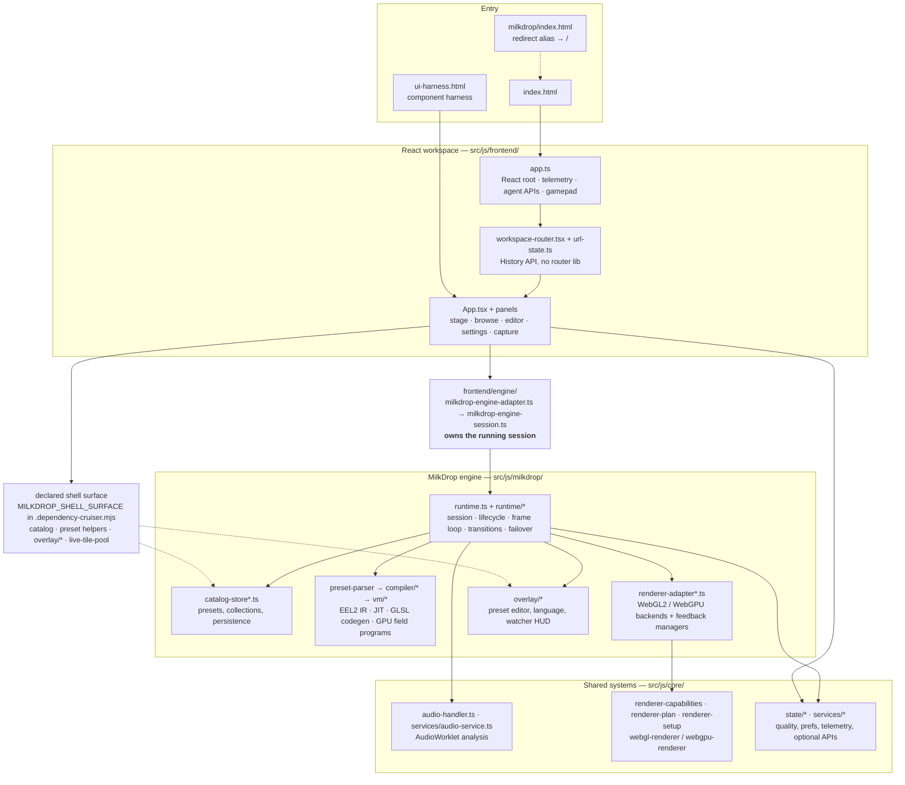
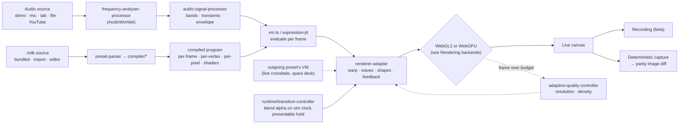

# Architecture Overview

The root route at `/` is the product surface. `milkdrop/index.html` exists only as a compatibility alias that redirects into `/`.

## Current shape

- `index.html` is the single app shell and bootstraps `src/js/app.ts`.
- `src/js/app.ts` mounts the React workspace and global runtime affordances.
- `src/js/frontend/*` owns route state and the workspace UI. Its `engine/` subfolder is the adapter layer that owns a running engine session.
- `src/js/milkdrop/*` remains the imperative visualizer engine, overlay, VM, renderers and catalog runtime.
- `packages/*` holds the parts with no dependency on the app, as workspace packages the app imports by name: the preset compiler, EEL interpreter and JIT, shader analysis, the WGSL generator for the compute VM, formatter and exporter (`milkdrop-toolchain`), the audio DSP and AudioWorklet (`audio-reactive`), the WCAG flash analysis and live governor (`flash-guard`), the EEL conformance corpus (`eel-conformance`), controller and TV-remote focus navigation (`gamepad-navigation`), and canvas-to-video recording at output presets (`canvas-video-exporter`). Their `stims-source` and `bun` export conditions point Vite, TypeScript and Bun at their sources, so a change there needs no build step. See [`packages/README.md`](../packages/README.md).
- Workspace-scene decorative layers are rendered with imperative Three.js, not a secondary React renderer.
- `src/js/core/*` owns shared renderer, audio, quality, persistence, and input systems, including the Three.js scene bootstrap (`toy-runtime*`, `web-toy.ts`, `toy-*-session.ts`) that the engine session mounts onto.
- There is no toy plugin layer. The old toys directory, the generated toy manifest, the hand-kept toys.json that outlived it, and the registry tooling and MCP tools around them were removed once it was clear they described a registry of one.

## Rendering backends

Other docs link here for which backend runs, which one is judged, and how visitors split.
- **Selection.** WebGPU is chosen where the browser ships it as stable and grants an adapter: Chrome and Edge 120+, Opera 99+, Samsung Internet 24+ and Safari 26+, never Firefox (`isWebGPUStableInThisBrowser` in [`core/renderer-query-override.ts`](../src/js/core/renderer-query-override.ts)). The capability probe asks for a core adapter, then the compatibility feature level ([`core/renderer-capabilities.ts`](../src/js/core/renderer-capabilities.ts)). WebGL2 runs everywhere else, when WebGPU initialization fails ([`core/renderer-setup.ts`](../src/js/core/renderer-setup.ts)), when the visitor turns on compatibility mode, and under `?renderer=webgl`; `?renderer=webgpu` forces WebGPU.
- **Per-preset exception.** A preset whose WebGPU plan carries unsupported features is pinned to WebGL for the session and the page reloads into it ([`runtime/backend-fallback.ts`](../src/js/milkdrop/runtime/backend-fallback.ts)).
- **Full and safe WebGPU paths.** Low-power phones get the safe path: procedural descriptors off and feedback shaders replaced by a scalar approximation. Everything else gets the full path, including native TSL feedback ([`webgpu-query-override.ts`](../src/js/milkdrop/webgpu-query-override.ts)). The flags that tune the full path are listed in [Preset runtime](./MILKDROP_PRESET_RUNTIME.md#webgpu-descriptor-rollout-flags).
- **Which backend is judged.** WebGPU is the only backend measured against native projectM: every certified reference requires it. WebGL has no parity coverage; `bun run lab:backend-diff` compares the two backends with each other, without a reference. See the [parity plan](./MILKDROP_PROJECTM_PARITY_PLAN.md).
- **How visitors split.** Production telemetry counts events, not visitors, so a few long sessions move it. Over the 30 days to 2026-10-07, renderer-tagged events split 640 WebGPU to 632 WebGL ([Product moments](./PRODUCT_MOMENTS.md#policies)). Over the 30 days to 2026-10-13 they split 1,531 WebGPU to 477 WebGL, with 1,713 untagged (`bun run telemetry:report --days=30`). WebGL carried about half of the tagged events in the first window and a quarter in the second, so a visible change is verified on both.

## Runtime map

Boot path and module ownership. React reaches the engine at two tiers: `frontend/engine/` owns the session, runtime, renderers and VM, and every other frontend module may import only the declared shell surface.



## Frame data flow

What moves per frame, once a session is running.



- **Equations.** The VM runs per-frame programs through the JIT every frame. Per-pixel and per-point programs go one of two ways: on the full WebGPU path, [`gpu-field-planner.ts`](../packages/milkdrop-toolchain/src/compiler/gpu-field-planner.ts) lowers each one into a field program evaluated inside the mesh, wave or motion-vector material; on WebGL, and for any program the planner cannot place, the CPU JIT runs it per vertex.
- **Shaders.** A preset's warp and comp blocks are parsed once. WebGL compiles the GLSL that [`shader-analysis-glsl.ts`](../packages/milkdrop-toolchain/src/compiler/shader-analysis-glsl.ts) emits; WebGPU builds TSL node graphs from the same parse in [`feedback-manager-webgpu-tsl.ts`](../src/js/milkdrop/feedback-manager-webgpu-tsl.ts).
- **Preset switch.** On WebGPU, when a blend is wanted and agent mode is off, [`runtime/preset-switch-warmup.ts`](../src/js/milkdrop/runtime/preset-switch-warmup.ts) compiles the incoming preset's pipelines before the fade starts, for up to 1,500 ms (#1422). [`runtime/transition-controller.ts`](../src/js/milkdrop/runtime/transition-controller.ts) then owns the blend alpha: it advances on simulation time, so a paused tab freezes the dissolve, and holds the reveal while the incoming shaders are not yet presentable. During a live crossfade the outgoing preset keeps stepping on its own VM and renders to a spare feedback deck until the transition settles.
- **Fallback and quality.** A backend that fails to initialize falls back to WebGL before the first frame. A frame over budget never changes backend: the adaptive-quality controller trims render resolution, then mesh and particle density.

## URL state (no router)

Stims uses the native History API instead of a client-side router. The app is a single-page SPA with one route (`/`); all persistent state lives in URL search params.
- URL reads → `window.location.search` via `readSessionRouteState()`
- URL writes → `window.history.replaceState(null, '', newUrl)` on state changes
- Back/forward → `popstate` event listener re-reads the URL

All URL reads go through one parser, [`src/js/core/url-params.ts`](../src/js/core/url-params.ts)
(`parseURLParams`), so the parameter surface is auditable in one file.

Canonical session params (read + written by the app):
- `preset` — active preset id
- `collection` — collection tag (normalized to `collection:<tag>`)
- `tool` — active panel: `browse` | `capture` | `editor` | `settings`
- `audio` — audio source: `demo` | `file` | `microphone` | `tab` | `youtube`
- `agent` — automation/testing mode (`true`)
- `embedded` — embed/player mode (`true`)
- `yt` / `t` — shared YouTube video id and start offset in seconds
- `experience` — written only when a legacy slug must be surfaced as invalid

Legacy aliases still read on boot: `panel` (`looks` → `browse`), `preview` →
`embedded`, `audio=sample` → `demo`, `audio=mic` → `microphone`.

Read-only QA / override params:
- `renderer` — `webgl` | `webgpu` | `auto`
- `corpus` — deterministic corpus override (e.g. `certification`)
- `stats` — `1` | `0` (legacy alias for the debug HUD; `1` persists it, `0` clears it)
- `tv` / `tvMode` — smart-TV override
- `maxPixelRatio`, `particleBudget`, `shaderQuality`, `lockQualityStep`, `powerSaver`
- `reduceFlashing` — `1` turns Reduce flashing on for the visit without saving it; no value turns it off
- `mockAudio`, `mockFrequency`
- `milkdrop-webgpu-{main-wave,custom-waves,mesh,motion-vectors,feedback,fallback,compute-vm,render-bundles,branch-desugar}` — see [Preset runtime](./MILKDROP_PRESET_RUNTIME.md#webgpu-descriptor-rollout-flags)
- `component`, `props`, `grid` — UI harness page (`ui-harness.html`)
- `debug=hud` — on-canvas debug HUD
- `liveTiles`, `strudel` — prototype flags (presence-only)

Feature-local params (read and written within one feature, not session state):
- `sync` — watch-together room name (sync transport; `SyncSessionBridge`)
- `modal` — rendering-capability dialog state (`webgl-check.ts`)

Hash params:
- `#code=<base64>` — a full `.milk` source to load in the editor
- `#t=<seconds>` — YouTube start offset, only for pasted YouTube URLs

- Unknown query params are preserved during canonicalization.
- Unsupported legacy `experience` slugs are surfaced as an invalid-experience state instead of silently booting another shell.

Primary implementation:
- [`src/js/core/url-params.ts`](../src/js/core/url-params.ts) — single read parser
- [`src/js/frontend/url-state.ts`](../src/js/frontend/url-state.ts) — session route read/write + canonicalization
- [`src/js/frontend/contracts.ts`](../src/js/frontend/contracts.ts)
- URL synchronization hook: `useWorkspaceRouteState()` in [`src/js/frontend/workspace-hooks.ts`](../src/js/frontend/workspace-hooks.ts)

## Frontend ownership

### App bootstrap

- [`src/js/app.ts`](../src/js/app.ts) renders [`src/js/frontend/App.tsx`](../src/js/frontend/App.tsx) into `#app` through the workspace router.
- In agent mode it installs the `window.stims.agent` driver ([`core/agent-driver.ts`](../src/js/core/agent-driver.ts)) before rendering, so the driver exists by the time `#stims-main` does and `ready()` can be called on it.
- After the first paint it installs crash and renderer telemetry, gamepad navigation and the older `window.stimState` surface ([`core/agent-api.ts`](../src/js/core/agent-api.ts)). Capture scripts such as `play-toy`, `stims-ctl` and `lab:visual` still read `window.stimState`.
- The automation API for agents and e2e tests is `window.__stims_agent` ([`frontend/agent-state.ts`](../src/js/frontend/agent-state.ts)), which App installs in every mode. See [`docs/agents/browser-automation.md`](./agents/browser-automation.md).
- The engine's chunks load only once a session needs them. A bare landing boots the decorative attract render in idle time; a `?preset=` or `?audio=` arrival mounts once the launch page has painted (`afterLoadPhasePainted('launch-rendered')` in [`workspace-hooks.ts`](../src/js/frontend/workspace-hooks.ts)), so the page naming the preset is not sharing the connection with them. `bun run check:bundle-size` fails a build that puts three.js or its WebGPU bundle on the eager path.

### Workspace UI

- [`src/js/frontend/App.tsx`](../src/js/frontend/App.tsx) owns:
  - top navigation
  - launch controls
  - preset browsing and search
  - session stage container
  - settings surface
  - canonical URL synchronization
  - focused-session state
- [`src/css/app-shell.css`](../src/css/app-shell.css) owns the workspace presentation layer, scoped with `@scope (.stims-shell)`.

### Engine seam

The seam has two tiers, both enforced by `bun run check:architecture` through the rules in [`.dependency-cruiser.mjs`](../.dependency-cruiser.mjs):
- **`frontend/engine/` owns the session.** [`milkdrop-engine-adapter.ts`](../src/js/frontend/engine/milkdrop-engine-adapter.ts) re-exports the session built in [`milkdrop-engine-session.ts`](../src/js/frontend/engine/milkdrop-engine-session.ts). Only this folder may import the runtime, renderers, feedback managers, VM or compiler entry (`engine-runtime-only-via-adapter`). The adapter owns:
  - mount and dispose, and pausing the preview
  - preset loading and history, playback pause and single-frame step
  - audio source changes
  - panel/tool opening and collection changes
  - quality, autoplay, transition mode and the manual crossfade
  - editor source and field updates
  - import/export, duplicate and delete
  - diagnostics, audio levels and snapshot subscription
- **The declared shell surface.** Any other frontend module may import a `src/js/milkdrop/` module only if it is listed in `MILKDROP_SHELL_SURFACE` (`frontend-engine-seam`): catalog types and store helpers, preset helpers such as credit, preview and id resolution, the `overlay/` subtree, `live-tile-pool.ts`, and a few `runtime/` helpers. On 2026-10-13, 33 frontend files outside `engine/` imported through it; for example `EditorSurface.tsx` loads the editor panel and `use-live-preset-tile.ts` the tile pool. The list is the public surface, so adding to it is a review decision; the first question is whether the capability belongs on the adapter instead.
- Decorative shell visuals are handled with imperative Three.js, not a secondary React renderer. Keep actual MilkDrop rendering in the imperative engine.

## MilkDrop engine ownership

- [`src/js/milkdrop/runtime.ts`](../src/js/milkdrop/runtime.ts) is the long-lived imperative session runtime; it composes the collaborators in [`runtime/`](../src/js/milkdrop/runtime) (lifecycle, frame loop, transition controller, switch warm-up, catalog coordinator, backend failover, persistence, presentation).
- [`src/js/milkdrop/overlay/`](../src/js/milkdrop/overlay) provides the imperative preset editor (`EditorPanel`, its panes and CodeMirror language support), which `EditorSurface.tsx` mounts, plus source diffs and the watcher HUD. The browse, settings, and capture surfaces are React panels in `src/js/frontend/`.
- [`packages/milkdrop-toolchain/src/compiler.ts`](../packages/milkdrop-toolchain/src/compiler.ts), [`compiler/`](../packages/milkdrop-toolchain/src/compiler), [`vm.ts`](../src/js/milkdrop/vm.ts), and [`vm/`](../src/js/milkdrop/vm) are the preset compilation and execution path: EEL2 is parsed to an IR, the JIT runs it on the CPU, and the descriptor plan decides what the GPU runs.
- Shader code reaches the GPU three ways:
  - **WebGL warp and comp shaders** compile from the GLSL that [`shader-analysis-glsl.ts`](../packages/milkdrop-toolchain/src/compiler/shader-analysis-glsl.ts) emits.
  - **WebGPU warp and comp shaders** are TSL node graphs built in [`feedback-manager-webgpu-tsl.ts`](../src/js/milkdrop/feedback-manager-webgpu-tsl.ts) from the same parsed shader AST; three.js compiles them to WGSL at render time. The compiler emits no WGSL for them.
  - **Per-pixel and per-point equations on WebGPU** become field programs: [`gpu-field-planner.ts`](../packages/milkdrop-toolchain/src/compiler/gpu-field-planner.ts) classifies and lowers a block or returns null to keep it on the CPU, [`gpu-descriptor-plan.ts`](../packages/milkdrop-toolchain/src/compiler/gpu-descriptor-plan.ts) attaches the result to the plan, and the node materials in [`renderer-backends/webgpu-procedural-materials.ts`](../src/js/milkdrop/renderer-backends/webgpu-procedural-materials.ts) evaluate it.
- [`wgsl-generator.ts`](../packages/milkdrop-toolchain/src/compiler/wgsl-generator.ts) compiles EEL to WGSL compute programs for the compute VM ([`vm-gpu.ts`](../src/js/milkdrop/vm-gpu.ts)), which is off by default (`?milkdrop-webgpu-compute-vm=1`) because readback made it slower than the CPU JIT. Shader-text work on WebGPU belongs in the TSL manager, not here.
- [`preset-dataflow.ts`](../packages/milkdrop-toolchain/src/preset-dataflow.ts) analyses the compiled IR statically, following the VM's persistence and reset rules, to say which audio signals can reach each control and drawn program; `lab:dataflow`, the catalog's audio-reactivity score, `lab:edit-eval` and the editor's Tune chips read it.
- [`src/js/milkdrop/renderer-adapter.ts`](../src/js/milkdrop/renderer-adapter.ts) and its WebGL/WebGPU siblings own draw submission and the feedback-buffer chain.

The React shell drives engine capabilities through the adapter; the engine owns rendering and the editor panel it composes.

## Shared systems

- [`src/js/core/renderer-capabilities.ts`](../src/js/core/renderer-capabilities.ts) probes WebGPU/WebGL support.
- [`src/js/core/settings-panel.ts`](../src/js/core/settings-panel.ts) owns shared quality preset state, alongside [`state/quality-preset-store.ts`](../src/js/core/state/quality-preset-store.ts) and [`services/adaptive-quality-controller.ts`](../src/js/core/services/adaptive-quality-controller.ts).
- [`src/js/core/state/browser-storage.ts`](../src/js/core/state/browser-storage.ts) is the single defensive accessor for `localStorage`/`sessionStorage`. Reach for it instead of hand-rolling try/catch around storage.
- [`src/js/core/audio-handler.ts`](../src/js/core/audio-handler.ts) and [`services/audio-service.ts`](../src/js/core/services/audio-service.ts) own source selection and the AudioWorklet analysis chain.
- [`src/js/core/state/render-preference-store.ts`](../src/js/core/state/render-preference-store.ts) owns renderer preferences, including compatibility mode. Import it directly — the old `core/render-preferences.ts` re-export shim is gone.
- [`src/js/core/motion-preferences.ts`](../src/js/core/motion-preferences.ts) owns motion-state persistence.
- [`src/js/core/services/webmidi-controller.ts`](../src/js/core/services/webmidi-controller.ts) owns MIDI device tracking, per-device persisted CC mappings, learn mode, and hot-plug recovery; a virtual "Claude (MCP)" device shares the same pipeline so MCP `session_midi_*` tools and physical hardware bind and drive parameters identically. The live binding to engine parameters is mounted in `App.tsx` rather than inside a settings panel, so it keeps working regardless of which UI is open.
- For an implementation map that separates shipped systems, partial certification, beta behavior, optional APIs, and scaffolding, see [`TECHNICAL_ACHIEVEMENTS.md`](./TECHNICAL_ACHIEVEMENTS.md). Which backend runs where is set out in [Rendering backends](#rendering-backends), and [`TESTING.md`](./TESTING.md) says what evidence each change needs.

## Edge runtime & Cloudflare architecture

Stims pairs its browser-native visualizer client with a serverless edge backend on Cloudflare Workers:
- **Site Worker with Static Assets**: The entire production bundle (`dist/`) is served at the edge with smart routing. Navigations hit [`functions/_middleware.ts`](../functions/_middleware.ts) first for dynamic SEO, JSON-LD, and Open Graph rewrites via `HTMLRewriter`.
- **Workers AI & Vectorize**: `/api/visual-search` runs semantic search using `@cf/baai/bge-base-en-v1.5` embeddings over Vectorize indices (with fallback to cosine scanning over D1 database storage). It serves "By sound" in the finder, and "By look" and Nearby only for presets with no preview vector. Catalog presets are matched on the device from `public/milkdrop-presets/visual-vectors.bin` (rows named in `visual-vectors.json`), EmbeddingGemma 2 embeddings of each rendered preview built by `bun run catalog:visual-embeddings` ([`experiments/visual-embeddings/`](../experiments/visual-embeddings/README.md)). `/api/generate-preset` uses reasoning and coding models to synthesize `.milk` source on the fly.
- **D1 SQL & R2 Storage**: D1 (`stims-gallery`) holds the preset embeddings behind the `/api/visual-search` fallback; R2 (`stims-static`) holds the preset preview images served to the browse grid and Open Graph cards.
- **Durable Objects & WebSockets (Hibernation API)**: [`scripts/sync-room-worker.ts`](../scripts/sync-room-worker.ts) implements an optional, separately deployed watch-together room service with hibernating WebSockets. Availability and billing depend on deployment and usage.
- **Vite and Worker build**: Vite builds the browser app; the site build bundles the Worker entrypoint and static assets. `wrangler.site.jsonc` defines deployment bindings. Optional AI, search, and room services require their own configuration; a frontend build does not establish their availability.

## Retired compatibility layer

The old DOM shell (`loader.ts`, `router.ts`, `toy-view.ts`, `library-view*`, `bootstrap/*`) is gone, and nothing outside the React workspace boots the engine. The only surviving compatibility surface is `milkdrop/index.html`, which preserves search and hash while redirecting to `/`. Route new work through the React workspace and the engine adapter.

## Verification anchors

Use these checks when changing architecture-sensitive areas:

```bash
bun run check
```

```bash
bun run test tests/unit/frontend-url-state.test.ts tests/unit/app-shell-route-sync.test.ts tests/unit/agent-api.test.ts
```

The architecture boundary gate:

```bash
bun run check:architecture
```

Stale documentation paths are themselves gated:

```bash
bun run check:stale-paths
```
