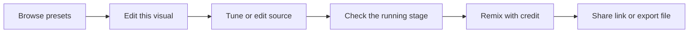

# Track 0 — Play

Start with a preset you enjoy. Change one thing, watch the stage, and share the result. The later tracks explain the equations behind those edits.

## 1 · Find one you love

Open [toil.fyi](https://toil.fyi/) and use Browse. Search matches catalog titles, authors, and tags; collections narrow the results. Hosted similarity search is an optional service, so a natural-language visual query may not be available in every deployment. Preset credits preserve the community's authors and accumulated remix names.

## 2 · Open it in the editor

Choose **Edit this visual**. The studio shows the `.milk` source used by the preset and tools for tuning, inspection, diagnostics, and versions. On a first edit, **Add a slow spin** gives you a visible change to try.

## 3 · Turn the knobs

Use **Tune** to adjust controls for the loaded source, such as zoom, warp, rotation, decay, waveform, and shape parameters. Controls write changes into the draft. Compare the source and stage after a change; some equations override a base value each frame, so a slider may have less effect than you expect. Diagnostics and Inspect help explain that dependency.

The **Insert** pane offers equation snippets. Add one at a time and watch the result before adding another. [Track 1](./01-how-milkdrop-thinks.md) explains the per-frame and per-pixel sections they modify.

## 4 · Remix with credit

Open the editor's **⋯** menu and choose **Remix** to create a draft from the current preset. Keep the original credit and any remix lineage. Stims carries attribution metadata into supported remix and sharing flows; that metadata records the supplied lineage rather than verifying authorship independently.

Keep a `.milk` export as a portable backup. Local drafts and version history stay in your browser and are not cross-device storage.

## 5 · Optional AI help

**Explain** and **Refine** can help when a supported provider is configured. Explain describes the source; Refine proposes a source change. Inspect the change and check the stage before keeping it. Hosted service availability, local inference setup, and a supplied provider key affect which actions work. You can complete this course without AI.

## 6 · Share it

Use Share or **Copy link to this preset** to create a remix URL. Depending on the browser, sharing opens a native sheet or copies the link. Open the resulting URL in a fresh tab to confirm it carries your edit.

The `#code=` payload supports legacy base64, UTF-8 source encoding, and compressed source. Share links have a size limit; export a `.milk` file for source that cannot fit. Format compatibility also varies across players, so test the exported file in the intended runtime before describing it as compatible.

When ready to contribute a preset, see [contributing presets](../../CONTRIBUTING.md#contributing-presets).

## Quick reference

| Action | Where | Result |
| --- | --- | --- |
| Browse | Workspace | Catalog search and collections |
| Edit | Edit this visual | Live source and studio panes |
| Tune | Studio | Controls tied to the loaded source |
| Remix | Editor **⋯** menu | A draft retaining supplied credit lineage |
| Explain / Refine | Studio assistance | Provider-dependent explanation or proposed edits |
| Share | Share or Copy link | Source in a portable URL, within size limits |
| Export | Editor menu | A `.milk` source file |

For audio and capture setup, see the [user guide](../USER_GUIDE.md). Next: [Track 1 — How MilkDrop thinks](./01-how-milkdrop-thinks.md).
