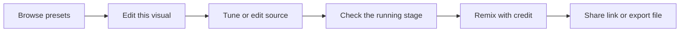

# Track 0 — Play

Start with a preset you enjoy. Change one thing, watch the stage, and share the result. The later tracks explain the equations behind those edits.

## 1 · Find one you love

Open [toil.fyi](https://toil.fyi/) and use Browse. Search matches titles, authors, tags, and, for some presets, words for how they look, such as "tunnel" or "galaxy"; collections narrow the results. With a preset on stage, **Play a similar-looking preset** in the dock plays one that looks like it, and **Find a preset → By look** lists more, ranked in your browser from each preset's preview image.

Credits keep each preset's authors, including the names a remix chain accumulated.

## 2 · Open it in the editor

Choose **Edit this visual**. The studio shows the `.milk` source used by the preset and tools for tuning, inspection, diagnostics, and versions. On a first edit, **Add a slow spin** gives you a visible change to try.

## 3 · Turn the knobs

Use **Tune** to adjust controls for the loaded source, such as zoom, warp, rotation, decay, waveform, and shape parameters. Controls write changes into the draft. Compare the source and stage after a change; some equations override a base value each frame, so a slider may have less effect than you expect. Diagnostics and Inspect help explain that dependency.

The **Insert** pane offers equation snippets. Add one at a time and watch the result before adding another. [Track 1](./01-how-milkdrop-thinks.md) explains the per-frame and per-pixel sections they modify.

## 4 · Remix with credit

Open the editor's **⋯** menu and choose **Remix** to create a draft from the current preset. Remix copies the original credit and any remix lineage into the draft; keep them. It records the names it was given and cannot verify who wrote what.

Keep a `.milk` export as a portable backup. Local drafts and version history stay in your browser and are not cross-device storage.

## 5 · Optional AI help

**Explain** and **Refine** send the source to an AI service the site runs. Explain describes what the preset does; when the service does not answer, it shows a summary worked out in your browser from the equations instead. Refine proposes a change as a diff for you to check on the stage before applying it, and shows an error when the service does not answer. Nothing else in this course uses them.

## 6 · Share it

Use Share or **Copy link to this edit** (it reads _this preset_ until you change something) to create a remix URL. Depending on the browser, sharing opens a native sheet or copies the link. Open the resulting URL in a fresh tab to confirm it carries your edit.

The link carries the preset source after `#code=`, so nothing is stored on a server, and links have a size limit: export a `.milk` file for source that does not fit. projectM, Butterchurn, and Winamp can render an exported file differently from Stims, so check it in the player you plan to use.

The [remix thread](https://github.com/zz-plant/stims/discussions/1341) on GitHub Discussions collects one-equation edits of a featured preset; other finds go in [Discussions](https://github.com/zz-plant/stims/discussions).

When ready to contribute a preset, see [contributing presets](../../CONTRIBUTING.md#contributing-presets).

## Quick reference

| Action           | Where              | Result                                           |
| ---------------- | ------------------ | ------------------------------------------------ |
| Browse           | Workspace          | Catalog search and collections                   |
| Edit             | Edit this visual   | Live source and studio panes                     |
| Tune             | Studio             | Controls tied to the loaded source               |
| Remix            | Editor **⋯** menu  | A draft retaining supplied credit lineage        |
| Explain / Refine | Studio assistance  | Provider-dependent explanation or proposed edits |
| Share            | Share or Copy link | Source in a portable URL, within size limits     |
| Export           | Editor menu        | A `.milk` source file                            |

For audio and capture setup, see the [user guide](../USER_GUIDE.md). Next: [Track 1 — How MilkDrop thinks](./01-how-milkdrop-thinks.md).
